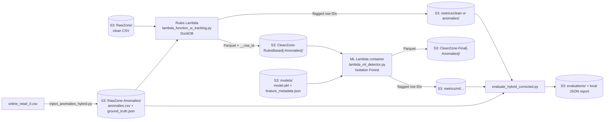

# Hybrid Data Quality Pipeline on AWS (Rules + ML)

A serverless data quality pipeline for the **Online Retail II** dataset (UCI, ~1.07M transactions, Dec 2009 – Dec 2011).
Raw CSV files dropped in S3 are cleaned in two sequential stages:

1. **Rule-based checks** – a DuckDB-powered AWS Lambda that removes rows violating business rules.
2. **ML anomaly detection** – a containerised AWS Lambda running an **Isolation Forest** that catches statistical outliers the rules can't express.

To measure how well this works, anomalies are deliberately injected into a copy of the data together with a **ground truth** file, and every flagged row is traced back to its original position so **Precision, Recall and F1** can be computed for *Rules-only* vs *Hybrid (Rules + ML)*.

---

## Architecture

### S3 bucket layout

| Prefix | Written by | Contents |
|---|---|---|
| `RawZone/` | you (upload) | Original clean `online_retail_II.csv` |
| `RawZone-Anomalies/` | `inject_anomalies_hybrid.py` | Corrupted CSV + `online_retail_II_ground_truth.json` |
| `CleanZone-RulesBased/`, `CleanZone-RulesBased-Anomalies/` | Rules Lambda | Parquet that passed the rules (keeps `__row_id`) |
| `CleanZone-Final/`, `CleanZone-Final-Anomalies/` | ML Lambda | Final Parquet after ML filtering |
| `metrics/{clean,anomalies}/YYYY/MM/DD/` | Rules Lambda | Per-run JSON: counts, timings, per-rule removals, `all_flagged_row_ids` |
| `metrics/ml/{clean,anomalies}/YYYY/MM/DD/` | ML Lambda | Per-run JSON: `ml_flagged_count`, `flagged_row_ids` |
| `models/` | `train_isolation_forest.py` | `isolation_forest_model.pkl`, `feature_metadata.json` |
| `evaluations/` | `evaluate_hybrid_corrected.py` | Rules-vs-Hybrid evaluation reports |

**Row tracking:** the Rules Lambda adds `__row_id` (the row's position in the source CSV) and passes it through to the ML stage, so IDs flagged by either stage can be matched against the ground truth. Because the stages run in sequence, a row removed by the rules never reaches the ML model – Rules and ML flags should never overlap (the evaluator warns if they do).

---

## Stage 1 – Rule-based checks

`lambda_function_w_tracking.py` (current version). Triggered by S3 uploads to `RawZone/` or `RawZone-Anomalies/`.

Before the rules run, it removes spaces from column names (`Customer ID` → `CustomerID`) and trims/upper-cases `StockCode`, `Invoice` and `Description`.

| Group (env toggle) | Rule | Row is removed when… |
|---|---|---|
| Basic checks (`ENABLE_BASIC_CHECKS`) | Valid price | `Price` is null/non-numeric, or negative **unless** it's a bank-debt adjustment (`StockCode = 'B'` and invoice starts with `A`) |
| Business rules (`ENABLE_BUSINESS_RULES`) | Cancellation sign | Invoice starts with `C` but `Quantity > 0` |
| | Regular-invoice sign | Invoice doesn't start with `C`, `Quantity < 0`, and `CustomerID` is present |
| | Zero quantity | `Quantity = 0` |

Rules are based on what the data actually means, so they don't produce false positives on legitimate data:

- **Missing `CustomerID` is not an error.** These are guest checkouts and operational entries (postage, adjustments).
- **Negative quantities are valid on cancellations.** A `C` invoice is expected to have them.
- **Negative quantities with no customer are valid.** These are stock write-offs and adjustments.

Other settings: `BUCKET_NAME`, `LOG_LEVEL` (`ERROR` / `INFO` / `DEBUG`).

## Stage 2 – ML anomaly detection

- **Training** – `ML Layer/train_isolation_forest.py` trains a scikit-learn `IsolationForest` (`n_estimators=100`, `contamination=0.001`, `random_state=42`) on the original clean CSV and uploads the model and feature metadata to `s3://<bucket>/models/`.
- **Features (32)**:
  - Numeric: price, quantity, total amount, and their absolute values.
  - Pattern flags: decimal quantity, round price/quantity, high-price/low-quantity, low-price/high-quantity, extreme price/quantity.
  - Time: hour, day of week, month, day of month, weekend.
  - Category: is-cancellation, price sign, quantity sign, StockCode frequency, one-hot top-10 countries plus "Other".
- **Inference** – `ML Layer/lambda_ml_detector.py` is triggered by Parquet files in `CleanZone-RulesBased[-Anomalies]/`. It caches the model between invocations, removes rows predicted as anomalies (`-1`), and writes the final Parquet and the ML metrics.
- **Deployment** – the ML Lambda is deployed as a **container image**, because scikit-learn and pandas exceed the Lambda layer size limit. `ML Layer/deploy_container.sh` does the following:
  - Creates the ECR repo `ml-anomaly-detector` in `eu-north-1`.
  - Builds and pushes the image from `ML Layer/Dockerfile` (base image `public.ecr.aws/lambda/python:3.11`).
  - Creates or updates the function `lambda-ml-detector` with 2048 MB memory and a 300 s timeout.
  - Creates its IAM role with S3 access.
  - Prints the S3 trigger configuration to apply.

  `build_and_upload_layer.sh` is the earlier layer-based approach that was replaced by the container.

## Anomaly injection & ground truth

`inject_anomalies_hybrid.py` (v4) loads the clean CSV from `RawZone/`, corrupts a random set of distinct rows, and uploads the corrupted CSV and `online_retail_II_ground_truth.json` (row IDs plus the reason each was corrupted) to `RawZone-Anomalies/`. Thresholds are relative to the data's own 99th percentile (P99) of price and quantity.

| Type | Anomaly | Max rows |
|---|---|---|
| **Rule-based** – rules should catch | Cancellation with positive quantity | 500 |
| | Regular invoice with negative quantity | 300 |
| | Zero quantity | 200 |
| **ML-detectable** – ML should catch | Extreme price (10–50× P99) | 250 |
| | Extreme quantity (10–50× P99) | 250 |
| | Extreme total amount (price 5–20× and quantity 5–20× P99) | 200 |
| | Unusual price/quantity ratio (luxury item ×1, or £0.01 × huge bulk) | 150 |
| | Decimal quantity | 100 |
| | Suspiciously round price/quantity (e.g. £100 × 1000) | 100 |

## Evaluation

`evaluate_hybrid_corrected.py` downloads the ground truth and the latest Rules and ML metrics, then compares:

- **Rules-only** – rows flagged by Stage 1
- **Hybrid** – the union of Stage 1 and Stage 2 flags

For each approach it reports the confusion matrix, Precision, Recall, F1 and Accuracy, plus the F1 improvement from adding ML and how many of the ML-only catches were real anomalies versus false positives. The report is saved locally as `hybrid_evaluation_<timestamp>.json` and uploaded to `evaluations/`.

A separate *ML-only* score isn't reported. The ML stage only sees rows the rules let through, so scoring it alone against the full dataset would be misleading.

---

## How to run

**Prerequisites**
- An AWS account and the AWS CLI configured (the scripts use the default credential chain; no keys are stored in the code).
- An S3 bucket. Code defaults to `datasourcebucket1109`; change `BUCKET_NAME` in the scripts and Lambda env vars.
- Docker, and Python 3.11 with `pandas numpy boto3 scikit-learn duckdb pyarrow`.
- The dataset: [Online Retail II (Kaggle mirror)](https://www.kaggle.com/datasets/mashlyn/online-retail-ii-uci).

**Steps**

1. Upload `online_retail_II.csv` to `s3://<bucket>/RawZone/`.
2. Deploy the **Rules Lambda** from `lambda_function_w_tracking.py` (Python runtime, with DuckDB available, e.g. via a layer). Add an S3 trigger for the `RawZone/` and `RawZone-Anomalies/` prefixes with suffix `.csv`, and give it read/write access to the bucket. Uploading the clean CSV produces the clean-baseline metrics.
3. Train the model: `cd "ML Layer" && python train_isolation_forest.py`. This expects the CSV at `../online_retail_II.csv`.
4. Deploy the **ML Lambda**: `cd "ML Layer" && ./deploy_container.sh`. Then add S3 triggers for **both** `CleanZone-RulesBased/` and `CleanZone-RulesBased-Anomalies/` with suffix `.parquet`. The command the script prints only covers the first prefix.
5. Inject anomalies: `python inject_anomalies_hybrid.py`. Uploading the result starts Rules → ML automatically.
6. When both Lambdas have finished, evaluate with `python evaluate_hybrid_corrected.py`.

---

## Repository structure

**Current pipeline**

| File | Purpose |
|---|---|
| `lambda_function_w_tracking.py` | **Rules Lambda (current)**: rules, row-ID tracking, writes to `CleanZone-RulesBased*` |
| `ML Layer/train_isolation_forest.py` | Feature engineering + Isolation Forest training, uploads model to S3 |
| `ML Layer/lambda_ml_detector.py` | **ML Lambda (current)** |
| `ML Layer/Dockerfile`, `ML Layer/deploy_container.sh` | Container build & deployment of the ML Lambda |
| `inject_anomalies_hybrid.py` | **Anomaly injector (current, v4)**: rule-based and ML-detectable anomalies plus ground truth |
| `evaluate_hybrid_corrected.py` | **Evaluator (current)**: Rules-only vs Hybrid |

**Earlier stages, kept for reference**

| File | Purpose |
|---|---|
| `test.py`, `df_prof.py` | Initial dataset profiling with DuckDB and first anomaly experiments |
| `lambda_function.py`, `lambda_mvp.py` | MVP Lambda (null CustomerID + price > 0 rules) and a local runner for it |
| `lambda_function_modular.py`, `test_lambda_function_modular.py` | Modular rule groups with env toggles, incl. data-integrity checks; local test runner |
| `Major Update/lambda_function.py` | Row-ID tracking version that wrote to `CleanZone*/` (replaced by `lambda_function_w_tracking.py`) |
| `inject_anomalies.py`, `inject_anomalies_v2.py` | Earlier injectors: rule violations only, then with ground truth and the first ML-type anomalies |
| `evaluate_performance.py`, `evaluate_hybrid_performance.py` | Rules-only evaluation; first 3-way evaluator (Rules / ML / Hybrid) |
| `compare_metrics.py` | Compares rule metrics from the clean run with the anomalous run |
| `ML Layer/build_and_upload_layer.sh` | Earlier Lambda-layer packaging of scikit-learn (replaced by the container) |

---

## Known limitations / to-do

- `ML Layer/Dockerfile` copies a `requirements.txt` that isn't committed: `.gitignore` excludes all `*.txt` files. Add it, e.g. with `!ML Layer/requirements.txt`, so the image can be rebuilt from the repo.
- The Isolation Forest is trained on the raw CSV, including rows the rules would remove. Training on rule-cleaned data would give the model a cleaner idea of "normal".
- The bucket name, region and file paths are hardcoded in several scripts. Moving them to config or env vars would make the project easier to reuse.
- The injector uses unseeded randomness, so each run produces a different ground truth.
